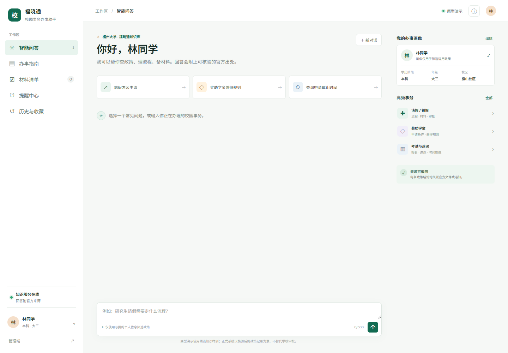

# 福晓通

> 面向福州大学学生的校园事务智能办事助手

[在线体验](https://modao.cc/proto/RXDXHlcLto8ebhZYV3MNe8/sharing?view_mode=read_only&screen=rbpVaTLNX8pb7I5Z5) · [系统设计说明书](docs/奶娃工程_系统设计说明书.pdf) · [数据库设计说明书](docs/奶娃工程_数据库设计说明书.pdf)



## 项目简介

校园事务信息分散在学校官网、学院通知和不同业务入口中。福晓通将政策查询、流程指引、材料准备和时间提醒整合到一个工作台，让学生能更快找到适用规则，并获得清晰、可执行的下一步建议。

首期聚焦三类高频事务：

- 请假与销假
- 国家奖学金
- 优秀学生综合奖学金

## 核心功能

- **智能问答**：围绕具体校园事务给出分步骤办理建议。
- **政策溯源**：回答展示政策来源、发布部门和核验状态。
- **办事指南**：按事务类型浏览、筛选和搜索政策。
- **材料清单**：将办理要求整理为可勾选的准备清单。
- **提醒中心**：记录需要关注的截止时间和后续动作。
- **历史与收藏**：保存问答记录及常用政策。
- **个性化画像**：结合培养层次、年级和校区展示更匹配的信息。
- **政策管理**：展示政策版本、核验状态和更新入口。

## 产品方案

福晓通采用“结构化政策知识库 + 单事务 Agent + 受控工具 + 证据门禁”的方案。系统先识别用户要办理的事务，再检索适用政策、检查证据状态并生成结构化回答；当政策缺失、过期或仍待核验时，不输出确定性结论，而是提示用户查看官方通知或联系对应部门。

当前仓库提供可交互原型和概要设计材料。原型用于展示产品流程与界面，不接入学校审批系统或真实通知渠道；具体政策以学校最新官方文件为准。

## 在线体验

- **墨刀原型**：<https://modao.cc/proto/RXDXHlcLto8ebhZYV3MNe8/sharing?view_mode=read_only&screen=rbpVaTLNX8pb7I5Z5>
- **本地原型**：打开 `prototype/index.html`，或在仓库目录运行：

  ```bash
  python -m http.server 8000 -d prototype
  ```

  然后访问 <http://localhost:8000>。

## 设计文档

| 文档 | 内容 |
|---|---|
| [系统设计说明书](docs/奶娃工程_系统设计说明书.pdf) | 系统架构、Agent 流程、接口、部署、安全及 UML 设计 |
| [数据库设计说明书](docs/奶娃工程_数据库设计说明书.pdf) | ER 模型、关系模型、ORM 映射、索引、权限及 Agent 数据边界 |
| [团队博客稿](blog-post.md) | 项目原型设计与概要设计说明 |
| [`diagrams/`](diagrams/) | 用例图、活动图、类图、时序图、协作图及数据库图示 |

## 目录结构

```text
.
├─ prototype/           # 可交互前端原型
├─ docs/                # 正式设计说明书 PDF
├─ diagrams/            # UML 与数据库图示
├─ evidence/            # 原型与文档验证记录
├─ scripts/             # 图示和文档构建脚本
├─ system-design.md     # 系统设计源稿
├─ database-design.md   # 数据库设计源稿
└─ blog-post.md         # 团队博客稿
```

## 团队

**奶娃工程**

052403146-蔡明润、102401603-张馨恬、102401606-黄丽婷、102401416-唐捷、102401605-王乐禾、102401502-王钰涵、152402217-陈霁然、102401403-潘岳、102401601-李佳雨。
