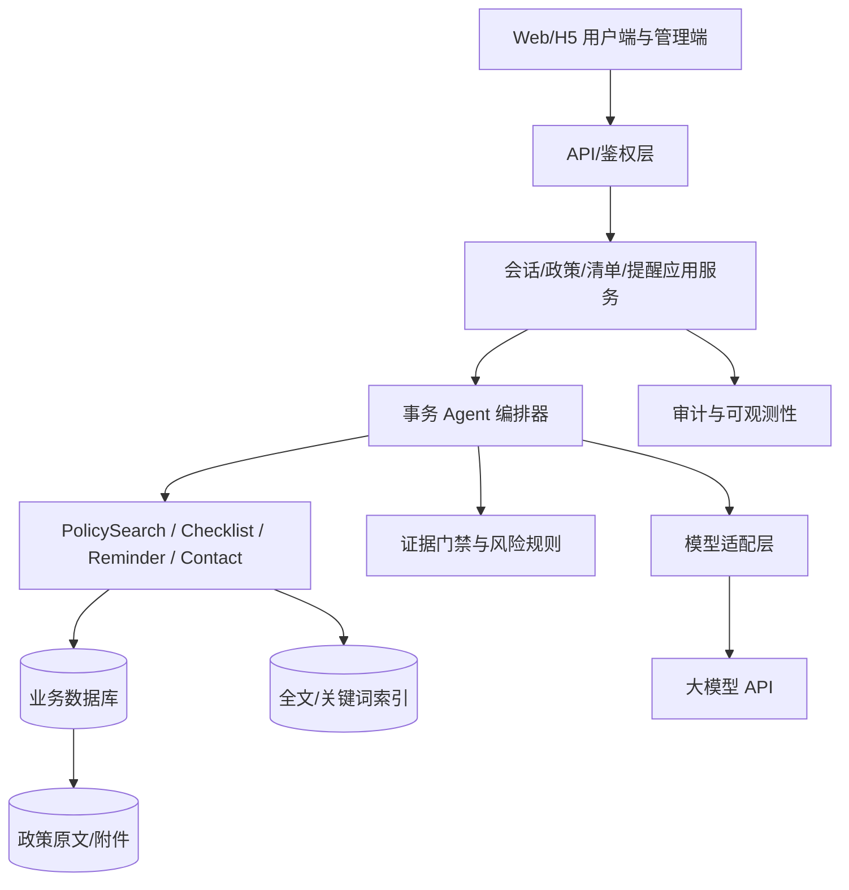

# 2026秋软工实践 奶娃工程——项目原型设计+概要设计

> **发布说明：**本文为奶娃工程团队博客园发布稿。墨刀公开预览链接已补入，并已在匿名窗口核验可访问；发布时仍需由团队账号完成博客园登录和发布。本文只需要由团队博客发布一次。

## 作业信息

| 项目 | 内容 |
|---|---|
| 作业所属课程 | [202601 软件工程（福州大学）](https://edu.cnblogs.com/campus/fzu/202601SofwareEngineering) |
| 作业要求 | [第二次团队作业：原型设计+概要设计](https://edu.cnblogs.com/campus/fzu/202601SofwareEngineering) |
| 作业的目标 | 在第一次需求分析基础上，完成可交互原型、分层概要设计、UML 设计、数据库设计和后续开发协作计划，重点说明领域 Agent 如何与软件功能结合。 |
| 团队名称 | 奶娃工程 |
| 团队成员学号-名字 | 052403146-蔡明润；102401603-张馨恬；102401606-黄丽婷；102401416-唐捷；102401605-王乐禾；102401502-王钰涵；152402217-陈霁然；102401403-潘岳；102401601-李佳雨 |
| 本文整理人 | 待团队确认；成员名单见下文，本文不代填未经确认的个人分工 |
| 博客提交 Deadline | 2026-11-09 |

## 一、项目概述：为什么做校园事务智能办事助手

校园事务信息分散在学校官网、学院通知、规章制度和不同业务入口中。学生常见的困难不是完全找不到信息，而是不知道哪个版本适用、材料是否齐全、流程应该先做什么，也不确定网上答案是否可靠。

团队对 56 份有效问卷进行分析后发现：71.43% 的受访者认为信息分散是主要困难，57.14% 遇到过材料不全而白跑，73.22% 愿意使用校园事务智能办事助手；另一方面，73.21% 担心回答不准确，73.21% 担心来源不可靠，82.14% 希望按照年级、专业和校区筛选政策，78.58% 需要截止时间提醒。

因此，我们没有把目标设定为“什么都能回答的聊天机器人”，而是设计一个**有证据、有边界、能给出下一步行动的校园办事助手**。首期明确聚焦请假/销假、国家奖学金、优秀学生综合奖学金三类事务；具体政策内容必须经团队核验后再进入知识库。

## 二、原型设计

### 2.1 原型工具与交付链接

- **正式原型工具：**墨刀。
- **正式在线展示链接：**[墨刀只读预览](https://modao.cc/proto/RXDXHlcLto8ebhZYV3MNe8/sharing?view_mode=read_only&screen=rbpVaTLNX8pb7I5Z5)（访问权限：所有人；已用匿名窗口核验）。
- **本次架构负责人提供的离线补充原型：**`prototype/index.html`，用于补充演示 Agent 问答状态、证据来源、风险提示、材料清单、提醒确认、个人画像和管理端核验状态。它使用预设政策样例与浏览器 `localStorage`，不连接后端、实时政策检索、大模型、学校审批系统或真实通知服务；正式提交仍以团队发布的 Axure/墨刀原型为准。

原型不是单纯的聊天页面，而是把 Agent 输出拆成可执行组件：结论卡、适用条件、步骤列表、材料清单、官方来源、风险提示和下一步按钮。概要设计目标是让用户从回答进入清单、负责部门或提醒流程，并在有副作用的操作前确认；离线补充页只对其中可在浏览器本地演示的路径提供交互，反馈、部门联系和管理发布入口以演示提示为主。

### 2.2 用户端页面

| 页面 | 核心内容 | 交互规则 |
|---|---|---|
| 首页/事务分类 | 高频事项、搜索入口、能力边界 | 点击事项进入问答或政策详情 |
| 智能问答页 | 多轮对话、澄清问题、来源卡片 | 概要设计目标为缺关键条件时追问；离线补充页演示预设单轮问题和风险降级 |
| 政策详情页 | 条件、流程、材料、地点、截止时间 | 概要设计目标为展示发布部门、版本和核验日期；离线页仅展示示例卡片及可用来源弹窗 |
| 材料清单页 | 可勾选材料、保存、导出 | 概要设计目标包含导出；离线页演示确认后生成、本地勾选和持久化，不提供导出 |
| 提醒中心 | 事项、提醒时间、状态 | 概要设计目标为受控提醒渠道；离线页仅保存/删除浏览器本地的个人计划，不发送通知 |
| 历史/收藏页 | 会话和政策收藏 | 离线页演示历史和收藏展示及取消收藏；完整历史删除属于后续系统能力 |
| 个人画像页 | 学历阶段、年级、专业、校区 | 主动填写、可修改、说明用途 |
| 反馈/转人工页 | 未解决原因、部门联系方式 | 正式系统使用已核验数据；离线页仅显示演示提示，不提交真实反馈或联系部门 |

### 2.3 管理端页面

概要设计中的管理端提供政策草稿录入、来源链接检查、适用对象填写、原文片段定位、双人核验、发布/下线、过期标记和反馈处理。录入员与核验人角色分离；已发布版本不能静默覆盖，必须形成新版本和审计记录。离线补充页只呈现静态示例政策记录、核验提示和“新建草稿”演示入口，不实现真实录入、发布、下线或反馈处理。

### 2.4 原型交互亮点

1. **来源卡片前置：**回答不只给文本，还给政策名称、发布部门、发布日期、原文链接和最后核验时间。
2. **风险可见：**没有证据、政策冲突或可能过期时，界面显示“不确定/需人工确认”，而不是伪装成肯定答案。
3. **Agent 与功能结合：**Agent 负责理解和规划，确定性工具负责检索、清单、提醒和联系方式；用户能看到每个动作的结果。
4. **画像筛选：**用户主动填写学历、年级、专业、校区后，政策卡片显示“适用/不直接适用”的匹配结果。
5. **操作可回溯（设计目标）：**问答、引用、清单、提醒和反馈应在正式系统中按用户权限留痕、查看和删除；离线补充页只对历史、收藏、清单和提醒的本地演示状态提供有限操作。

## 三、概要设计与 UML

### 3.1 总体架构

系统采用前后端分离的模块化单体：表示层负责用户端和管理端；应用层负责 API、会话、政策、清单、提醒和反馈服务；领域层包含事务 Agent、证据门禁、政策模型和受控工具注册表；基础设施层负责关系数据库、检索索引、原文存储、模型适配和日志。



### 3.2 Agent 集成方式

首期采用“单事务 Agent + 多个确定性工具”，而不是多个大模型 Agent 互相协作：

1. Agent 识别意图和必要条件；
2. `PolicySearchTool` 按画像、事项、关键词和时效返回证据；
3. Agent 依据证据组织候选回答；
4. 证据门禁检查来源、适用对象、版本冲突、动态日期和风险；
5. 通过后返回结构化回答，否则保守降级并给出官方渠道/人工入口；
6. 清单、提醒、收藏和反馈等副作用操作必须经用户确认后调用工具。

### 3.3 主要 UML 设计清单

- **用例图：**学生咨询、筛选政策、查看来源、保存清单、创建提醒、反馈转人工；录入员和核验人负责知识生命周期；
- **活动图：**用户提问→安全检查→意图识别→条件补全→政策检索→证据校验→回答/降级；
- **类图：**User、UserProfile、Policy、PolicyVersion、Conversation、Message、Citation、Checklist、Reminder、Feedback 与 AgentOrchestrator、EvidenceGate、PolicySearchTool；
- **时序图：**以“本科生病假 5 天咨询审批人”为主线，展示前端、API、Agent、检索服务、数据库、模型适配器和证据门禁的消息传递；
- **协作图：**以 `sendMessage`、`handleMessage`、`search`、`generate`、`validate`、`persistAnswer` 描述对象协作。

本稿共提供 16 张静态图示：系统设计 10 张，数据库设计 6 张。数据库部分保留一张 ER 总览，并补充用户权限、政策证据、会话办事数据三张局部 ER 图，便于 PDF 打印阅读；局部图与总览使用同一组实体和关系。

## 四、数据库设计

数据库设计采用“政策主对象—政策版本—来源文件—回答引用”链路，确保政策更新后历史回答仍可追溯。核心表包括：用户与画像、角色、部门、政策、政策版本、适用对象、来源文件、会话、消息、回答、引用、材料清单、提醒、收藏、反馈、工具调用日志和审计日志。

### 4.1 核心关系

```text
USER 1—1 USER_PROFILE
USER 1—N CONVERSATION 1—N MESSAGE 1—N CITATION N—1 POLICY_VERSION
POLICY 1—N POLICY_VERSION 1—N POLICY_SOURCE N—1 SOURCE_DOCUMENT
POLICY 1—N POLICY_AUDIENCE；DEPARTMENT 1—N POLICY
USER 1—N CHECKLIST 1—N CHECKLIST_ITEM
USER 1—N REMINDER；USER 1—N FAVORITE；USER 1—N FEEDBACK
```

### 4.2 Agent 数据边界

Agent 不直接连接数据库。后端工具负责权限、字段投影、状态过滤、脱敏和审计，只向 Agent 返回已发布且未过期的政策证据包。向量检索是后续增强项，关系数据库仍是政策事实源；回答引用必须保存 `policy_version_id` 和原文片段。

## 五、团队协作记录与开发计划

### 5.1 本次作业分工

#### 5.1.1 团队成员登记

- `052403146-蔡明润`
- `102401603-张馨恬`
- `102401606-黄丽婷`
- `102401416-唐捷`
- `102401605-王乐禾`
- `102401502-王钰涵`
- `152402217-陈霁然`
- `102401403-潘岳`
- `102401601-李佳雨`

角色分配尚待团队确认，本稿不根据成员顺序或学号推断分工。正式分工应由团队确认后写入 GitHub issue/PR，并以实际提交记录作为协作证据。

本次作业需要落实的职责包括：版本与验收统筹、政策知识核验、Agent 与系统架构、前后端接口、墨刀原型、数据库设计、测试验收及博客整理。职责与成员的对应关系在确认前不作声明。

### 5.2 后续每周计划

| 周期 | 里程碑 | 产出 |
|---|---|---|
| 11-09—11-15 | 冻结技术栈和 API/数据库契约 | 接口文档、迁移脚本、分支规则 |
| 11-16—11-22 | 知识库 P0 | 请假/销假、国家奖学金、优秀学生综合奖学金政策及核验记录 |
| 11-23—11-29 | 非生成式功能 | 政策详情、清单、画像、来源 |
| 11-30—12-06 | Agent P0 | RAG 检索、回答模板、证据门禁 |
| 12-07—12-13 | 用户端联调 | 问答、提醒、历史、反馈 |
| 12-14—12-20 | 管理端和权限 | 核验发布、RBAC、审计 |
| 12-21—12-27 | 测试评测 | 20+问题集、回归报告、风险修复 |
| 12-28—01-03 | 部署演示 | Docker Compose、HTTPS、演示数据 |
| 01-04—01-10 | 答辩复盘 | 演示脚本、指标图和迭代清单 |

### 5.3 协作过程记录

本稿依据第一次团队作业材料与现有设计基线整理范围、Agent 边界、政策字段、接口状态、页面交互和风险场景。当前仓库仅提供本次交付材料，不把尚未形成的 issue、PR 或成员协作过程表述为既有事实；后续协作应通过 GitHub 留下可核验记录。

## 六、提交材料链接

> GitHub、PDF 和墨刀链接均已补入材料；墨刀链接已在匿名窗口复核。博客园正式发布仍需团队账号完成登录操作。

- GitHub 团队仓库：[https://github.com/trony33/fuxiaotong-campus-affairs](https://github.com/trony33/fuxiaotong-campus-affairs)
- [`奶娃工程_系统设计说明书.pdf`](https://github.com/trony33/fuxiaotong-campus-affairs/blob/main/docs/%E5%A5%B6%E5%A8%83%E5%B7%A5%E7%A8%8B_%E7%B3%BB%E7%BB%9F%E8%AE%BE%E8%AE%A1%E8%AF%B4%E6%98%8E%E4%B9%A6.pdf)
- [`奶娃工程_数据库设计说明书.pdf`](https://github.com/trony33/fuxiaotong-campus-affairs/blob/main/docs/%E5%A5%B6%E5%A8%83%E5%B7%A5%E7%A8%8B_%E6%95%B0%E6%8D%AE%E5%BA%93%E8%AE%BE%E8%AE%A1%E8%AF%B4%E6%98%8E%E4%B9%A6.pdf)
- 原型设计展示链接：[墨刀只读预览](https://modao.cc/proto/RXDXHlcLto8ebhZYV3MNe8/sharing?view_mode=read_only&screen=rbpVaTLNX8pb7I5Z5)
- 架构负责人基线文档：[04_Agent与系统架构最终稿（V1.0）](https://mi.feishu.cn/docx/WA5ud2GyGoyYBpxdcT4clwcLnwf)

## 七、总结

本次设计的核心不是把大模型嵌入页面，而是把领域知识、确定性工具和风险控制组织成可解释的系统闭环：**用户问题 → 事务识别 → 画像过滤 → 政策证据 → 受控生成 → 引用校验 → 可执行操作/保守降级**。这样既体现 Agent 的领域价值，也保留普通政策查询、流程详情和材料清单在模型不可用时的可用性。

后续开发应坚持 P0 闭环，先让请假/销假、国家奖学金、优秀学生综合奖学金三类代表性任务做到有来源、可追溯、能降级，再扩展更多校园事务。
