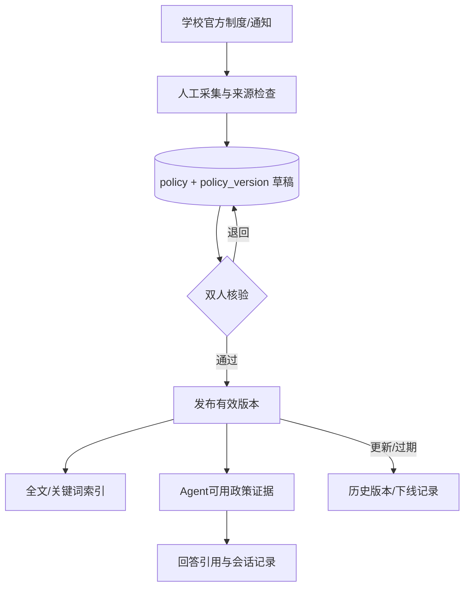
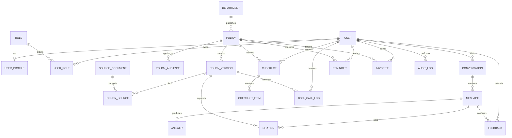
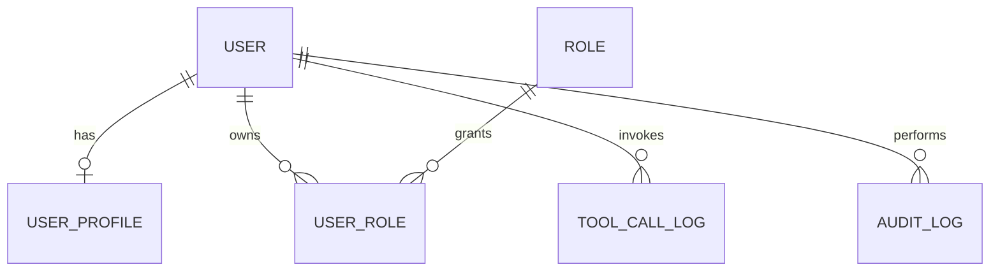
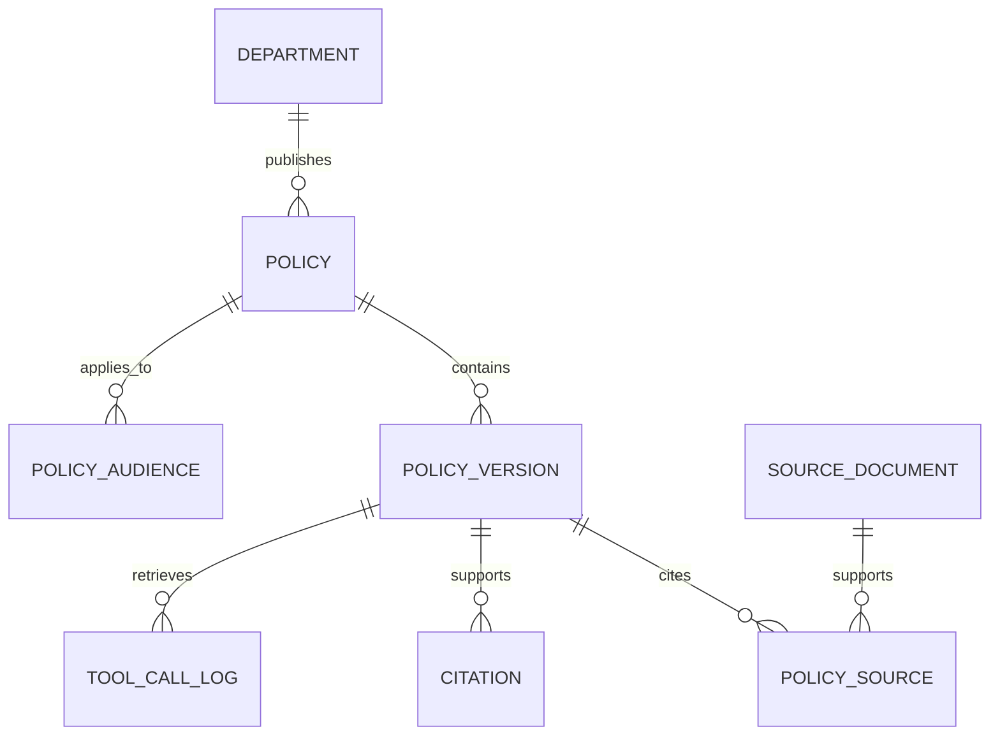
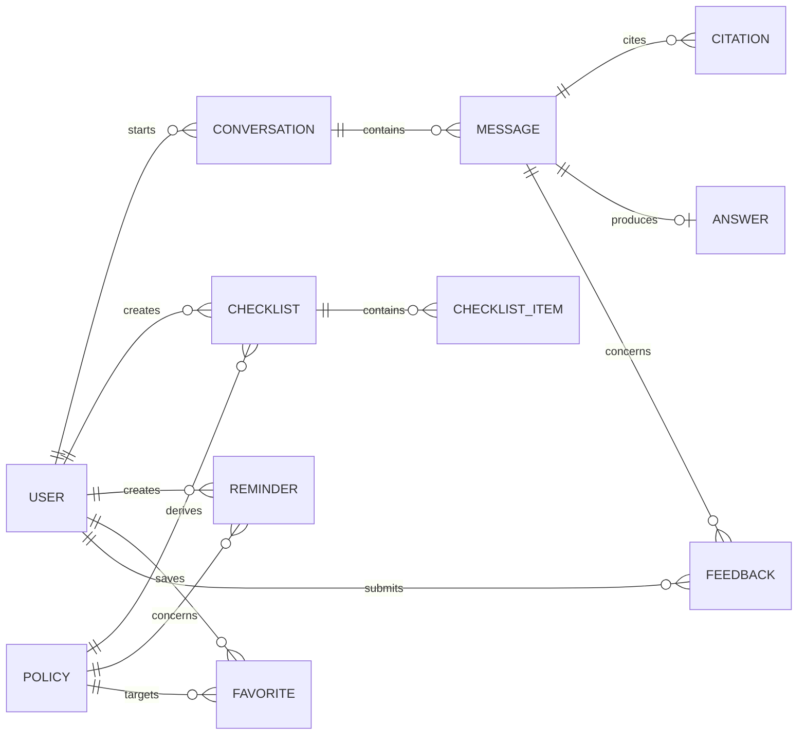
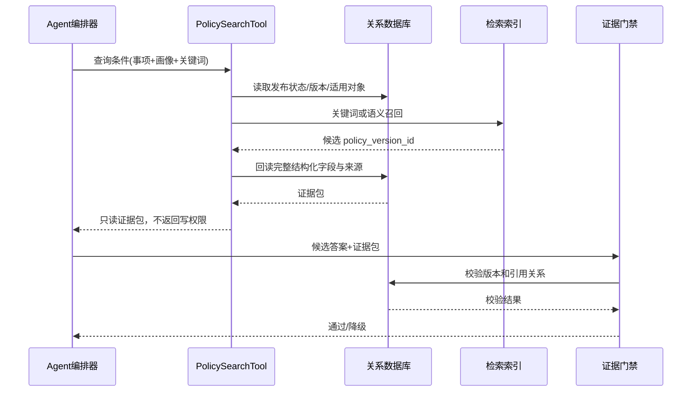

# 《奶娃工程_数据库设计说明书》

> **项目名称：** 校园事务智能办事助手<br>
> **文档版本：** v1.0（概要设计阶段）<br>
> **本稿整理人：** 待团队确认<br>
> **编制日期：** 2026-11-06<br>
> **团队名称：** 奶娃工程<br>
> **数据库基线：** PostgreSQL 15+ 或 MySQL 8.0（二选一，本文优先采用标准 SQL 表达）

## 0 术语与设计约定

| 术语 | 定义 |
|---|---|
| ER 图 | Entity-Relationship Diagram，实体—联系图 |
| ORM | Object-Relational Mapping，对象关系映射 |
| PK | Primary Key，主键 |
| FK | Foreign Key，外键 |
| RAG | Retrieval-Augmented Generation，检索增强生成 |
| RBAC | Role-Based Access Control，基于角色的访问控制 |
| UTC | Coordinated Universal Time，协调世界时；数据库时间统一存储 UTC，前端按东八区显示 |
| 软删除 | 使用 `deleted_at` 标记删除，不立即物理删除，便于审计和恢复 |
| 政策证据 | 政策版本、原文片段、来源链接和核验状态的组合 |

字段命名采用小写下划线；所有业务表含 `created_at`、`updated_at`，需要用户删除的数据按策略保留 `deleted_at`。枚举可使用数据库枚举或受控字符串，应用层和数据库层必须保持同一字典。

## 1 数据库设计目标与范围

数据库负责保存：

1. 用户、角色和最小用户画像；
2. 政策、政策版本、适用对象、部门、来源文件和核验记录；
3. 会话、消息、结构化回答、政策引用和工具调用审计；
4. 材料清单、清单项目、提醒、收藏和反馈；
5. 管理操作、模型调用和数据访问审计。

数据库不保存模型密钥，不把未核验的外部网页直接当作政策答案，不把完整个人敏感信息写入普通日志。向量索引不是首期必选持久化数据；若后续启用，应与政策版本通过 `policy_version_id` 关联，而不是替代关系库中的事实字段。

## 2 数据分层与生命周期



生命周期规则：政策先进入草稿，再经过来源可访问、关键条件可定位、适用对象明确、发布日期与核验时间完整等检查；只有 `policy.status = PUBLISHED` 且 `policy_version.expiry_status <> EXPIRED` 的版本可被 `PolicySearchTool` 返回为确定性证据。发布新版本不覆盖旧版本，旧版本保留以支持回答追溯。

## 3 概念结构设计（ER 图）

下图用于查看实体间的整体连接。打印时请结合 3.2—3.4 的局部 ER 图阅读关系名称和基数；局部图重复出现的实体表示同一张表，不增加新的实体或关系。



### 3.1 实体说明

| 实体 | 说明 | 关键约束 |
|---|---|---|
| `user` | 平台用户最小身份 | `account` 唯一；不存明文密码 |
| `user_profile` | 个性化筛选画像 | 与用户一对一；字段可为空 |
| `role/user_role` | RBAC 角色 | 普通学生、录入员、核验人、管理员 |
| `policy` | 稳定的政策业务对象 | 标题/事项/发布部门；不随版本覆盖 |
| `policy_version` | 某次发布的具体内容 | 版本号唯一；保存结构化字段和状态 |
| `policy_audience` | 政策适用对象 | 支持学历、年级、专业、校区等维度 |
| `department` | 负责部门和官方联系渠道 | 联系方式必须核验 |
| `source_document` | 官方原文或附件元数据 | 保存 URL、哈希、抓取时间，不默认保存全文 |
| `policy_source` | 政策版本与来源的多对多关系 | 可定位条款/页码/片段 |
| `conversation/message` | 用户问答记录 | 按用户隔离；支持删除 |
| `answer/citation` | 结构化回答及引用 | 每个政策结论应有引用 |
| `checklist/checklist_item` | 材料清单及勾选项 | 用户确认后创建 |
| `reminder` | 截止时间/事项提醒 | 用户所有权、时间和渠道校验 |
| `favorite` | 政策或流程收藏 | 用户+目标唯一 |
| `feedback` | 错误/未解决反馈 | 关联消息和处理状态 |
| `tool_call_log/audit_log` | Agent工具调用与管理审计 | 脱敏、可追溯、不可篡改策略 |

### 3.2 用户、角色与审计



### 3.3 政策版本、来源与引用



### 3.4 会话、回答与办事数据



## 4 关系数据模型

### 4.1 关系模式总览

```text
USER(user_id PK, account UK, display_name, status, created_at, updated_at, deleted_at)
USER_PROFILE(user_id PK/FK, education_level, grade, major, campus, consent_version, created_at, updated_at)
ROLE(role_id PK, role_code UK, role_name)
USER_ROLE(user_id PK/FK, role_id PK/FK, granted_by, granted_at)
DEPARTMENT(department_id PK, name, phone, office_location, official_url, verified_at, status)
POLICY(policy_id PK, matter_code, title, publisher_department_id FK, status, created_at, updated_at, deleted_at)
POLICY_VERSION(policy_version_id PK, policy_id FK, version_no, publish_date, expiry_status, last_verified_at, conditions_text, process_text, materials_text, location_text, deadline_text, official_url, source_excerpt, status, verified_by FK, verified_at, created_at)
POLICY_AUDIENCE(policy_audience_id PK, policy_id FK, audience_type, audience_value, match_operator)
SOURCE_DOCUMENT(source_document_id PK, title, source_url UK, publisher, published_at, content_hash, storage_uri, fetched_at, status)
POLICY_SOURCE(policy_version_id PK/FK, source_document_id PK/FK, locator, excerpt, relation_type)
CONVERSATION(conversation_id PK, user_id FK, title, status, created_at, updated_at, deleted_at)
MESSAGE(message_id PK, conversation_id FK, user_id FK, role, content, intent_code, risk_level, model_provider, model_name, latency_ms, created_at, deleted_at)
ANSWER(answer_id PK, message_id UK/FK, answer_text, steps_json, materials_json, suggested_actions_json, gate_result, created_at)
CITATION(citation_id PK, message_id FK, policy_version_id FK, field_name, excerpt, citation_order)
CHECKLIST(checklist_id PK, user_id FK, policy_id FK, title, status, created_at, updated_at, deleted_at)
CHECKLIST_ITEM(item_id PK, checklist_id FK, item_order, content, required_flag, completed, note, updated_at)
REMINDER(reminder_id PK, user_id FK, policy_id FK NULL, title, remind_at, channel, status, idempotency_key UK, created_at, updated_at)
FAVORITE(favorite_id PK, user_id FK, target_type, target_id, created_at, UNIQUE(user_id,target_type,target_id))
FEEDBACK(feedback_id PK, user_id FK, message_id FK NULL, reason_code, description, status, handler_id FK NULL, handled_note, created_at, updated_at)
TOOL_CALL_LOG(tool_call_id PK, user_id FK NULL, conversation_id FK NULL, message_id FK NULL, tool_name, request_json, result_code, policy_version_id FK NULL, latency_ms, created_at)
AUDIT_LOG(audit_id PK, actor_user_id FK NULL, action, object_type, object_id, before_hash, after_hash, request_id, created_at)
```

### 4.2 范式与反范式说明

- `policy` 与 `policy_version` 分离，避免政策更新造成历史引用失效；
- `policy_audience` 用行表示多种适用条件，避免在政策表中增加大量重复列；
- `policy_source` 和 `citation` 分别表示“版本的来源”和“某次回答引用了什么”，支持可追溯性；
- `steps_json`、`materials_json`、`suggested_actions_json` 是回答展示快照，事实仍以政策版本结构化字段为准；
- 消息正文和回答快照允许独立删除/脱敏，不影响政策知识库；
- 首期不存向量值；后续向量索引表只保存外部索引 ID、模型版本和 `policy_version_id`。

## 5 主要数据表设计与数据字典

### 5.1 `user` 用户表

| 字段 | 类型 | 空 | 键/默认 | 说明 |
|---|---|---:|---|---|
| `user_id` | BIGINT | 否 | PK | 用户标识 |
| `account` | VARCHAR(128) | 否 | UK | 登录账号或统一认证标识 |
| `display_name` | VARCHAR(80) | 是 |  | 展示名，非政策证据 |
| `status` | VARCHAR(20) | 否 | `ACTIVE` | `ACTIVE/LOCKED/DELETED` |
| `created_at` | TIMESTAMP | 否 |  | 创建时间 |
| `updated_at` | TIMESTAMP | 否 |  | 修改时间 |
| `deleted_at` | TIMESTAMP | 是 |  | 软删除时间 |

### 5.2 `user_profile` 用户画像表

| 字段 | 类型 | 空 | 键/默认 | 说明 |
|---|---|---:|---|---|
| `user_id` | BIGINT | 否 | PK/FK | 对应用户 |
| `education_level` | VARCHAR(20) | 是 |  | 专科/本科/硕士/博士 |
| `grade` | VARCHAR(20) | 是 |  | 年级或入学年份 |
| `major` | VARCHAR(120) | 是 |  | 专业 |
| `campus` | VARCHAR(80) | 是 |  | 校区 |
| `consent_version` | VARCHAR(30) | 否 |  | 画像使用说明版本 |
| `updated_at` | TIMESTAMP | 否 |  | 最近修改 |

### 5.3 `policy` 政策主表

| 字段 | 类型 | 空 | 键/默认 | 说明 |
|---|---|---:|---|---|
| `policy_id` | BIGINT | 否 | PK | 稳定业务 ID |
| `matter_code` | VARCHAR(40) | 否 | IDX | `LEAVE/SCHOLARSHIP/...` |
| `title` | VARCHAR(240) | 否 |  | 政策名称 |
| `publisher_department_id` | BIGINT | 否 | FK | 发布部门 |
| `status` | VARCHAR(24) | 否 | `DRAFT` | 政策主状态 |
| `created_at` | TIMESTAMP | 否 |  | 创建时间 |
| `updated_at` | TIMESTAMP | 否 |  | 修改时间 |
| `deleted_at` | TIMESTAMP | 是 |  | 软删除 |

### 5.4 `policy_version` 政策版本表

| 字段 | 类型 | 空 | 键/默认 | 说明 |
|---|---|---:|---|---|
| `policy_version_id` | BIGINT | 否 | PK | 版本标识 |
| `policy_id` | BIGINT | 否 | FK/IDX | 政策主对象 |
| `version_no` | VARCHAR(40) | 否 | UK(policy_id,version_no) | 版本号 |
| `publish_date` | DATE | 是 |  | 发布日期 |
| `expiry_status` | VARCHAR(20) | 否 | `MAY_EXPIRE` | 有效性 |
| `last_verified_at` | DATE | 否 |  | 最后核验日期 |
| `conditions_text` | TEXT | 是 |  | 办理条件 |
| `process_text` | TEXT | 是 |  | 办理流程 |
| `materials_text` | TEXT | 是 |  | 材料清单原文/结构化文本 |
| `location_text` | VARCHAR(500) | 是 |  | 地点 |
| `deadline_text` | VARCHAR(500) | 是 |  | 原样保留动态日期描述 |
| `official_url` | VARCHAR(1000) | 否 |  | 官方入口 |
| `source_excerpt` | TEXT | 否 |  | 可定位证据片段 |
| `status` | VARCHAR(24) | 否 | `DRAFT` | 版本状态 |
| `verified_by` | BIGINT | 是 | FK | 核验人 |
| `verified_at` | TIMESTAMP | 是 |  | 核验时间 |

### 5.5 `conversation/message/answer/citation` 会话与证据

`message.role` 取 `USER/ASSISTANT/SYSTEM`；`message.intent_code` 取 `ELIGIBILITY/PROCESS/MATERIAL/DEADLINE/CONTACT/EXPLANATION/OUT_OF_SCOPE`；`risk_level` 取 `LOW/MEDIUM/HIGH/UNKNOWN`。`citation` 必须关联政策版本，保存引用字段、片段和顺序。回答文本可以被用户删除，但引用审计是否保留由团队隐私策略决定。

### 5.6 `checklist/reminder/feedback` 任务辅助数据

- 清单项目使用 `item_order` 保证展示顺序；`required_flag` 表示政策要求，不由模型自由决定。
- 提醒使用 `idempotency_key` 防止重复创建；`remind_at` 必须晚于当前时间，渠道首期为 `IN_APP`。
- 反馈原因取 `WRONG/OUTDATED/MISSING_SOURCE/NOT_SOLVED/OTHER`，处理结论必须关联核验版本或部门渠道。

### 5.7 审计与工具调用

`tool_call_log` 记录工具名、脱敏后的输入摘要、返回码、命中的政策版本、耗时和请求关联 ID；不保存完整密钥、完整个人身份信息或未脱敏模型上下文。`audit_log` 记录管理端发布、下线、核验和权限变更，可采用追加写入和定期归档策略。

## 6 索引、约束与查询设计

### 6.1 关键索引

| 表 | 索引 | 用途 |
|---|---|---|
| `policy` | `(matter_code,status)` | 事项分类与发布状态过滤 |
| `policy_version` | `(policy_id,status,expiry_status)` | 取当前有效版本 |
| `policy_version` | `(last_verified_at,expiry_status)` | 过期复核任务 |
| `policy_audience` | `(audience_type,audience_value,policy_id)` | 用户画像匹配 |
| `conversation` | `(user_id,updated_at desc)` | 历史会话分页 |
| `message` | `(conversation_id,created_at)` | 会话消息排序 |
| `citation` | `(message_id,citation_order)` | 回答来源展示 |
| `reminder` | `(user_id,status,remind_at)` | 提醒调度 |
| `feedback` | `(status,created_at)` | 管理端处理队列 |
| `tool_call_log` | `(conversation_id,created_at)` | 追溯 Agent 调用链 |

### 6.2 全文检索策略

首期可用 `title、matter_code、conditions_text、process_text、materials_text、source_excerpt` 的全文/关键词索引。检索结果必须二次过滤：`policy.status = PUBLISHED`、`policy_version.status = PUBLISHED`、时效不是 `EXPIRED`，并按适用对象和官方来源层级排序。后续引入向量检索时，保留关键词检索作为可解释兜底。

### 6.3 典型查询逻辑

```sql
SELECT p.policy_id, p.title, pv.policy_version_id, pv.conditions_text,
       pv.process_text, pv.materials_text, pv.official_url,
       pv.last_verified_at, pv.expiry_status
FROM policy p
JOIN policy_version pv ON pv.policy_id = p.policy_id
LEFT JOIN policy_audience pa ON pa.policy_id = p.policy_id
WHERE p.status = 'PUBLISHED'
  AND pv.status = 'PUBLISHED'
  AND pv.expiry_status <> 'EXPIRED'
  AND p.matter_code = :matter
  AND (pa.audience_type = :audience_type OR pa.audience_type IS NULL)
ORDER BY
  CASE WHEN pa.audience_value = :audience_value THEN 0 ELSE 1 END,
  CASE WHEN pv.expiry_status = 'VALID' THEN 0 ELSE 1 END,
  pv.last_verified_at DESC;
```

应用层仍需检查多个版本是否存在冲突；数据库排序不能替代人工核验和证据门禁。

## 7 ORM 映射设计

### 7.1 实体—表映射

| 领域实体 | 数据表 | 映射关系 | 说明 |
|---|---|---|---|
| `User` | `user` | 1:1 `UserProfile`，1:N `Conversation` | 用户聚合根 |
| `UserProfile` | `user_profile` | 1:1 | 可选画像 |
| `Policy` | `policy` | 1:N `PolicyVersion`、1:N `PolicyAudience` | 政策聚合根 |
| `PolicyVersion` | `policy_version` | N:1 `Policy`，N:M `SourceDocument` | 可被引用的事实版本 |
| `Department` | `department` | 1:N `Policy` | 联系方式来源 |
| `Conversation` | `conversation` | 1:N `Message` | 会话聚合 |
| `Message` | `message` | 1:0..1 `Answer`，1:N `Citation` | 用户/助手消息 |
| `Answer` | `answer` | 1:1 `Message` | 回答展示快照 |
| `Citation` | `citation` | N:1 `PolicyVersion` | 引用关系 |
| `Checklist` | `checklist` | 1:N `ChecklistItem` | 用户副作用数据 |
| `Reminder` | `reminder` | N:1 `User`，N:1 `Policy`（可空） | 提醒 |
| `Feedback` | `feedback` | N:1 `User`，N:1 `Message`（可空） | 反馈 |

### 7.2 ORM 约束

- 外键删除默认限制；用户删除使用软删除或匿名化任务，不级联删除政策证据。
- 领域枚举与数据库字典统一；非法状态转换在领域服务中拒绝。
- `Policy` 聚合内部版本发布采用事务：写入版本、更新主状态、写入审计、刷新索引要么全部成功，要么回滚。
- `Checklist`、`Reminder` 和 `Favorite` 的所有权通过当前认证用户推导，禁止使用客户端传来的用户 ID 作为授权依据。

## 8 数据完整性与事务

### 8.1 事务边界

| 事务 | 包含操作 | 一致性要求 |
|---|---|---|
| 发布政策 | 写版本、核验记录、更新状态、审计 | 全部成功才可被检索 |
| 保存回答 | 写助手消息、回答快照、引用、工具日志 | 回答无引用则不得标记确定性 |
| 创建清单 | 读取政策材料、写清单和项目 | 用户确认后一次提交 |
| 创建提醒 | 校验政策/时间/所有权、写提醒、审计 | 幂等；重复请求不重复创建 |
| 处理反馈 | 更新状态、处理说明、关联核验版本 | 可追溯处理依据 |

### 8.2 约束规则

1. 同一政策的版本号唯一；已发布版本不能直接修改关键事实字段。
2. `official_url` 必须是 HTTPS 或经过白名单批准的官方域名。
3. `last_verified_at` 不能为空；动态截止日期存原文，不强制转换为具体日期。
4. 引用只能指向已发布或历史可追溯的政策版本；新回答不能引用已过期版本作为确定性结论。
5. 用户只能更新自己的清单项目、提醒、收藏和反馈；管理端读写按照角色授权。

## 9 安全、隐私与数据治理

- 数据库账号按应用读写、迁移、只读报表分离；生产环境禁用共享管理员账号。
- 连接使用 TLS；备份文件加密，密钥不与备份放在同一位置。
- 账号、学号、手机号等标识按最小化原则存储；不需要的字段不采集。
- 会话删除提供软删除后定期物理清理；用户导出/删除请求必须写审计。
- 日志字段脱敏，模型上下文不直接落普通日志；调试环境使用合成账号。
- 管理端发布和权限变更采用 RBAC + 二次确认；高风险操作记录 request ID。
- 政策原文存储采用内容哈希，定期检查远端来源是否变化，变化后进入待核验而非静默替换。

## 10 备份、恢复与运维

| 项目 | 设计 |
|---|---|
| 全量备份 | 每日一次，保留至少 7 个恢复点 |
| 增量/日志 | 课程项目可按小时导出关键变更；生产按数据库能力配置 |
| 原文附件 | 对象存储版本化，记录 SHA-256 内容哈希 |
| 恢复演练 | 发布前在独立环境恢复一次，核对政策版本、引用和审计 |
| 索引重建 | 从 `policy_version` 重建，不把索引当唯一事实源 |
| 删除请求 | 先软删除并阻断查询，再按保留期限物理清理 |
| 监控 | 连接池、慢查询、备份结果、检索命中率、引用缺失率 |

## 11 与 Agent 的数据交互边界



Agent 不能直接使用数据库连接；工具层负责 SQL/ORM、权限、字段投影、脱敏和审计。模型看到的是证据包，不是数据库表结构和其他用户数据。

## 12 验收清单

- [x] ER 图、关系数据模型和实体—表 ORM 映射；
- [x] 政策版本、原文来源、引用关系和核验状态；
- [x] 用户画像、会话、任务结果、清单、提醒和反馈存储；
- [x] 主键、外键、唯一约束、索引、事务和状态规则；
- [x] Agent 只读证据边界、审计和隐私设计；
- [x] 团队名称：奶娃工程；
- [x] 全体成员名单已登记；
- [ ] 最终数据库产品仍待开发阶段确认。
